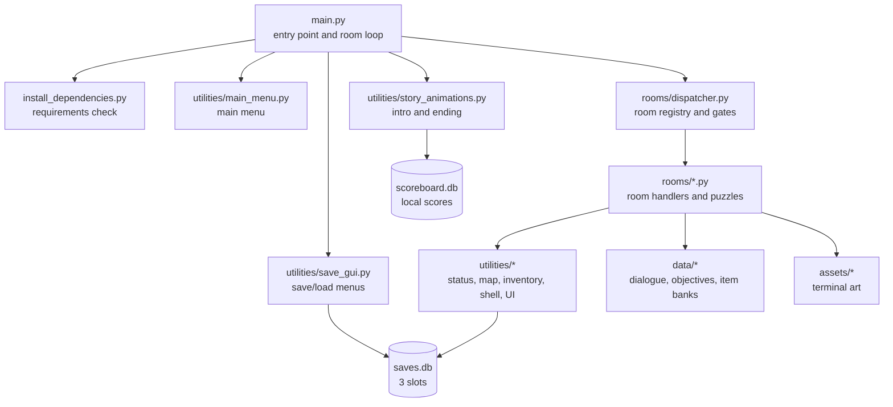
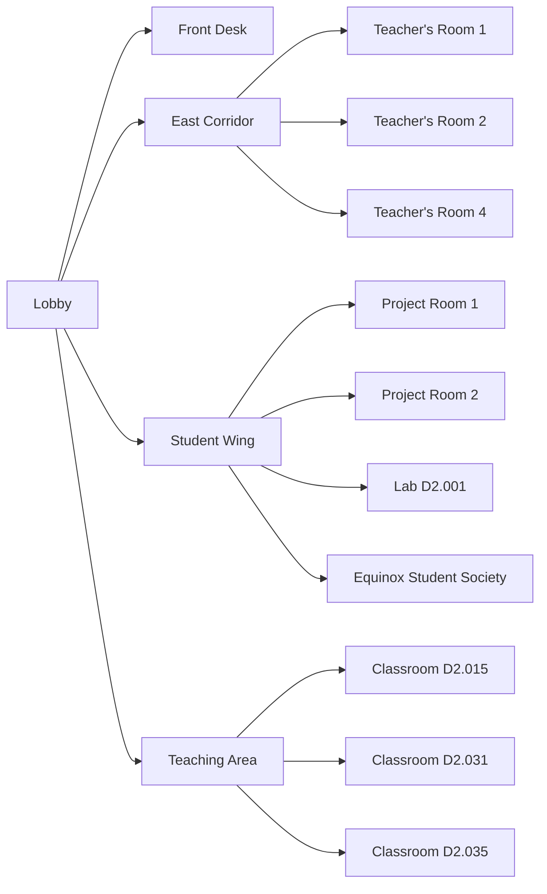

# Architecture & System Design

This document describes the current A-maze-ing-Delft runtime: how the entry point starts the game, how rooms are dispatched, where state lives, how saves and scores are persisted, and which parts of the repository are not yet connected.

The old `src/engine.py`, `src/parser.py`, `src/state.py`, and `src/display.py` architecture has been removed. The current game is a collection of room functions coordinated by `rooms/dispatcher.py`.

## Contents

- [System overview](#system-overview)
- [Runtime flow](#runtime-flow)
- [Room dispatch and objective gates](#room-dispatch-and-objective-gates)
- [State model](#state-model)
- [Persistence](#persistence)
- [Module responsibilities](#module-responsibilities)
- [UI and rendering](#ui-and-rendering)
- [Data layer](#data-layer)
- [Testing and CI](#testing-and-ci)
- [Known gaps](#known-gaps)

## System overview



The important boundary is that `main.py` owns the state dictionary and the room loop. Room modules do not call each other directly; they return the next room ID to the dispatcher/main loop.

## Runtime flow

1. `main.py` imports `install_dependencies.check_dependencies()` and calls it **before** importing the rest of the application.
2. `utilities.auto_color` is imported for its side effect: it replaces `builtins.print` with a colour-cycling wrapper.
3. `main.py` creates the initial `state` dictionary. The starting room is `lobby`, the objective is `0`, and the inventory is empty.
4. `display_main_menu()` loops until the player chooses `CONTINUE`, `NEW GAME`, `CREDITS`, `SCOREBOARD`, or `EXIT`.
   - `CONTINUE` opens `display_load_menu()` and replaces `state` with the selected save.
   - `NEW GAME` starts with the default state; it does not open a slot picker.
   - `CREDITS` shows the credits and returns to the menu.
   - `SCOREBOARD` shows local entries and returns to the menu.
   - `EXIT` leaves the program.
5. If the intro has not played, `play_intro()` runs with game time paused. The player can skip with Enter.
6. The room loop calls `enter_room(current, state)` repeatedly. Each handler runs its own command loop and returns the next room ID.
7. `enter_room("quit")` or `enter_room("exit")` ends the loop. Most room `quit` commands call `sys.exit()` directly.
8. When the player assembles A.I.G.I.S. in Lab D2.001, `play_game_complete()` runs the ending cutscene and offers to add the run to `scoreboard.db`.

There is no `game_phase` state and no separate `EXPLORATION`/`ASSEMBLY`/`CHAT_MODE` controller. The game is always in a room command loop until the player quits or completes the ending.

## Room dispatch and objective gates

`rooms/dispatcher.py` contains two dictionaries:

- `ROOM_HANDLERS` maps a room ID to its `enter_*` function.
- `ROOM_REQUIREMENTS` maps a room ID to `(minimum_objective_id, rejection_message)`.

When a handler returns a room ID, `main.py` stores it in `state["current_room"]` and passes it to the next `enter_room()` call.

### Registered rooms

| Room ID | Module | Display name | Minimum objective |
| --- | --- | --- | ---: |
| `lobby` | `rooms/lobby.py` | Lobby | 0 |
| `frontdesk` | `rooms/front_desk.py` | Front Desk | 1 |
| `eastcorridor` | `rooms/corridor_east.py` | East Corridor | 2 |
| `teachersroom1` | `rooms/teachers_room_1.py` | Teacher's Room 1 | 2 |
| `teachersroom2` | `rooms/teachers_room_2.py` | Teacher's Room 2 | 3 |
| `teachersroom4` | `rooms/teachers_room_4.py` | Teacher's Room 4 | 4 |
| `studentwing` | `rooms/corridor_student_wing.py` | Student Wing | 5 |
| `projectroom1` | `rooms/project_room_1.py` | Project Room 1 | none |
| `projectroom2` | `rooms/project_room_2.py` | Project Room 2 | 5 |
| `labd2001` | `rooms/lab_d2001.py` | Lab D2.001 | none |
| `equinoxstudentsociety` | `rooms/equinox_student_society.py` | Equinox Student Society | none |
| `teachingarea` | `rooms/corridor_teaching_area.py` | Teaching Area | 6 |
| `classroomd2015` | `rooms/classroom_d2015.py` | Classroom D2.015 | none |
| `classroomd2031` | `rooms/classroom_d2031.py` | Classroom D2.031 | none |
| `classroomd2035` | `rooms/classroom_d2035.py` | Classroom D2.035 | 6 |

Rooms marked "none" are still reached through a gated corridor. For example, Project Room 1 and Lab D2.001 are behind the Student Wing gate, while the three classrooms are behind the Teaching Area gate.

`rooms/store.py` defines `enter_store()` but is **not** in `ROOM_HANDLERS`, so the store is unreachable. `rooms/corridor_west.py` and `rooms/corridor_south.py` are unused duplicates of the Student Wing and Teaching Area modules.

### Gate behaviour

If the player's `current_objective_id` is below a room's minimum, the dispatcher prints the rejection message, waits 1.5 seconds, restores `state["current_room"]` to `state["previous_room"]`, and returns that room. The player remains in the corridor instead of entering the locked room.

`ROOM_REQUIREMENTS` does not contain a "permanently unavailable" entry, although the dispatcher supports `minimum_objective_id is None` for that case. No current room uses it.

### Room graph



Every room returns to its corridor (or, for the Front Desk, the Lobby) when the player leaves.

## State model

`state` is a plain dictionary created in `main.py` and passed by reference to every room handler. The full field list and persistence mapping are in [STATE_SCHEMA.md](STATE_SCHEMA.md).

The most important fields are:

| Field | Purpose |
| --- | --- |
| `current_room` | Room ID currently being executed. |
| `previous_room` | Room to return to when a gate rejects the player. |
| `current_objective_id` | Progression counter from 0 to 8. Also used for room gates and the Lab assembly check. |
| `visited` | Mapping of eleven challenge-room IDs to booleans. Used by the map. |
| `completed` | Mapping of eleven challenge-room IDs to booleans. Used by the status screen, map, and exploration percentage. |
| `inventory` | Display strings for collected items. |
| `student_id_obtained` | Special flag used by the Lobby's opening message. |
| `time_elapsed`, `start_time`, `is_gametime_paused` | Play-time accounting. |
| `has_intro_played` | Prevents the intro from replaying after a load. |

Room-local fields such as `projectroom1_progress` and `d2015_progress` are created when the room is entered and are not persisted. Project Room 2's colour order and Classroom D2.035's `seating_done` flag are module-level globals, so they also reset when the process restarts.

### Objective progression

The main chain is:

```text
0 start
  -> 1 Lobby: look around and take the Robot Chassis Frame
  -> 2 Front Desk: register and receive the Student ID card
  -> 3 Teacher's Room 1: answer n % 2 and receive the Staff Keycard
  -> 4 Teacher's Room 2: answer Mia, take the Wi-Fi Credentials
  -> 5 Teacher's Room 4: read the secret file and receive the API USB
  -> 6 Project Room 2: solve the colour puzzle and receive the mic/speaker combo
  -> 7 Classroom D2.035: solve the podium puzzle and take the motherboard
  -> 8 Classroom D2.015: solve the rover puzzle and take the memory sticks
  -> assemble A.I.G.I.S. in Lab D2.001
```

Project Room 1's Sensory Module, Classroom D2.031's key, and the Equinox quiz certificate are optional and do not advance `current_objective_id`.

## Persistence

### `saves.db`

`utilities/save_management.py` creates `saves.db` in the working directory. The schema is:

```sql
CREATE TABLE IF NOT EXISTS general (
    save_slot INTEGER PRIMARY KEY,
    player_name TEXT NOT NULL,
    current_room TEXT NOT NULL,
    previous_room TEXT,
    time_elapsed REAL NOT NULL,
    has_intro_played INTEGER NOT NULL,
    current_objective_id INTEGER NOT NULL,
    student_id_obtained INTEGER NOT NULL
);

CREATE TABLE IF NOT EXISTS room_visited_status (
    save_slot INTEGER NOT NULL,
    room_name TEXT NOT NULL,
    is_visited INTEGER NOT NULL,
    PRIMARY KEY (save_slot, room_name)
);

CREATE TABLE IF NOT EXISTS room_completed_status (
    save_slot INTEGER NOT NULL,
    room_name TEXT NOT NULL,
    is_complete INTEGER NOT NULL,
    PRIMARY KEY (save_slot, room_name)
);

CREATE TABLE IF NOT EXISTS inventory (
    save_slot INTEGER NOT NULL,
    item TEXT NOT NULL,
    PRIMARY KEY (save_slot, item)
);

CREATE TABLE IF NOT EXISTS store_items (
    save_slot INTEGER NOT NULL,
    item TEXT NOT NULL,
    PRIMARY KEY (save_slot, item)
);
```

`store_items` is created but not used by the current store or save code.

- `save_game(state, slot)` updates `time_elapsed`, writes the general row, and upserts one row per visited room, completed room, and inventory item.
- `load_save(slot)` reconstructs the state dictionary from those rows and resets `start_time` to the current time and `is_gametime_paused` to `False`.
- `get_save_info(slot)` reads the slot preview data for the save/load screens.
- Slots 1, 2, and 3 are supported.

The save code does not delete stale rows. If an item or room flag is removed from the state, its old row can remain in the database for that slot.

### `scoreboard.db`

`utilities/scoreboard.py` creates `scoreboard.db` with:

```sql
CREATE TABLE IF NOT EXISTS scoreboard (
    id INTEGER PRIMARY KEY AUTOINCREMENT,
    player_name TEXT NOT NULL,
    exploration_percent REAL NOT NULL,
    time_elapsed REAL NOT NULL
);
```

Entries are sorted by `exploration_percent DESC, time_elapsed ASC`. The ending asks whether to save the run; if the player agrees, `add_scoreboard_entry()` writes the player name, exploration percentage, and elapsed time.

## Module responsibilities

### Entry point and configuration

- `main.py` — dependency check, state initialization, main menu, save/load selection, intro, room loop.
- `install_dependencies.py` — compares installed distributions with `requirements.txt` and installs missing packages. It skips the check in a PyInstaller bundle.
- `pyproject.toml` — project metadata, Ruff configuration, and mypy overrides for optional LangChain packages.
- `requirements.txt` — runtime and development dependencies. LangChain packages are not included.

### Rooms

Each `rooms/*.py` module exports an `enter_*` function. The handler:

1. Usually sets `state["previous_room"]` to its own room ID. Project Room 1 is an exception; it leaves the previous value unchanged.
2. Marks the room visited.
3. Prints the room header and description.
4. Runs a command loop.
5. Updates completion flags, inventory, and objectives when a puzzle is solved.
6. Returns the next room ID when the player leaves.

`main.py` stores the returned room ID in `state["current_room"]` after the handler returns. Teacher's Room 4 is the one handler that also sets `state["current_room"]` directly.

Room-specific dialogue comes from `data/story_dialogue_bank.py`; shared look-around text comes from `data/look_around_dialogue_bank.py`.

### Utilities

- `utilities/main_menu.py` — arrow-key main menu and `read_key()`.
- `utilities/save_gui.py` — save/load slot screens.
- `utilities/save_management.py` — SQLite persistence.
- `utilities/scoreboard.py` — local scoreboard storage and display.
- `utilities/status_bar.py` — top bar, room display names, exploration percentage, play time.
- `utilities/check_status.py` — detailed status report.
- `utilities/game_map.py` — campus map with visited/completed colouring.
- `utilities/inventory_viewer.py` — scrollable inventory with item art and descriptions.
- `utilities/display_menu.py` — reusable command lists and selection menus.
- `utilities/print_helpers.py` — dialogue wrapping, objective text, and assembly-part notices.
- `utilities/centralized_commands.py`, `utilities/get_help.py` — shared help renderers with duplicated implementations.
- `utilities/clear_screen.py` — cross-platform screen clearing and status-bar refresh.
- `utilities/shell.py` — pure virtual shell used by Teacher's Room 4.
- `utilities/animations.py`, `utilities/story_animations.py` — puzzle animations, intro, ending.
- `utilities/loader.py` — short loading indicator.
- `utilities/colors.py`, `utilities/auto_color.py`, `utilities/display.py` — ANSI colours, automatic print colouring, and cp1252-safe output.
- `utilities/credits.py` — scrolling credits.
- `utilities/chat.py`, `utilities/langchain.py` — optional AI chat helpers; not imported by the current game.

### Assets

`assets/nixos.py` renders the NixOS-style logo used by Teacher's Room 4. `assets/__init__.py` is empty.

## UI and rendering

The game uses Rich for tables, panels, prompts, and live text, with ANSI escape sequences from `utilities/colors.py`. `utilities/auto_color.py` replaces `print` so ordinary `print()` calls receive a rotating dialogue colour; messages containing words such as "wrong", "locked", "invalid", or "error" are printed in red.

The status bar is refreshed by `clear_screen()`, which reads the state from the `__main__` module. This coupling is intentional in the current design: room modules call `clear_screen()` without passing state.

## Data layer

All game text is Python data, not JSON:

- `data/story_dialogue_bank.py` — intro, ending, and per-room dialogue.
- `data/look_around_dialogue_bank.py` — room look-around descriptions.
- `data/objective_dialogue_bank.py` — objective text keyed by `current_objective_id`.
- `data/item_description_bank.py` — inventory descriptions.
- `data/item_render_bank.py` — ASCII art for inventory items.

There is no `data/game_state.json` and no `data/system_prompt.txt`.

## Testing and CI

The test suite is in `tests/` and uses pytest. It currently contains 93 tests covering:

- menu rendering and keyboard selection;
- inventory viewer behaviour;
- SQLite save/load behaviour;
- the virtual shell parser and filesystem;
- Teacher's Room 4 integration.

CI runs Ruff, mypy, and pytest on pushes and pull requests to `main`:

```bash
python -m ruff check .
python -m mypy .
python -m pytest -q
```

## Known gaps

The current code is playable through the main eight-step objective chain, but these pieces are unfinished or inconsistent:

1. **Store is unreachable.** `rooms/store.py` is not registered in `ROOM_HANDLERS`. The `coin_balance` and `store_available_items` keys it expects are not in the initial state or the save schema. Coins printed by Project Room 1 are not added to a persistent balance.
2. **AI chat is unwired.** `utilities/chat.py` and `utilities/langchain.py` exist, but no module imports them. The ending is a cutscene. `requirements.txt` also does not include the LangChain packages those files import.
3. **Project Room 1 cannot open Locker 2.** The locker requires `"brass key"`, but the room's `room_loot` list starts empty and no interaction adds the key. The other four lockers can be opened; the Sensory Module from Locker 1 is optional for the main ending.
4. **Classroom D2.031 reward mismatch.** The room awards a `"Classroom 2.021 key"`, but there is no D2.021 room. Objective 7 says to search D2.015 and D2.031 for memory sticks; only D2.015 awards memory sticks.
5. **Lab puzzle loop.** `while box_puzzle_check() != 3` compares a boolean with the integer 3, so the loop never exits on its own. After arranging the boxes, type `quit` inside the puzzle; the completion check then runs. The `assemble` command also prints the "not all components" message after the ending because `play_game_complete()` returns `None`.
6. **Room-local progress is not saved.** `projectroom1_progress`, `d2015_progress`, `seating_done`, and the Project Room 2 colour order are not part of `saves.db`. Reloading or re-entering a room can reset a puzzle.
7. **Status labels are imprecise.** `check_status()` labels completed rooms as "Rooms Explored" and does not use the `visited` mapping for that section.
8. **Front Desk help lists an unimplemented command.** The help text mentions `take <item>`, but the Front Desk command loop has no `take` branch.
9. **Unused corridor duplicates.** `rooms/corridor_west.py` and `rooms/corridor_south.py` are not imported by the dispatcher; the active modules are `corridor_student_wing.py` and `corridor_teaching_area.py`.
10. **Version drift.** `pyproject.toml` requires Python 3.12+, CI uses 3.10, and the Dockerfile uses 3.11. Align these before packaging or releasing.

These gaps are documented so contributors do not mistake them for intended behaviour. Fixing them is a code change, not a documentation change.
