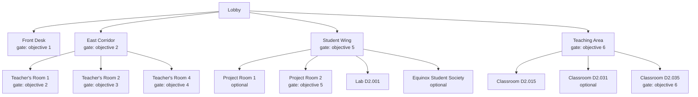

# A-maze-ing-Delft Game Design Document

This document describes the game that is currently implemented in the repository. It covers the story, objective chain, room graph, item distribution, puzzle mechanics, optional content, and ending.

> **Spoiler warning:** this document contains puzzle solutions and item locations.

## Contents

- [Premise](#premise)
- [Design framing](#design-framing)
- [Objective chain](#objective-chain)
- [Room graph and gates](#room-graph-and-gates)
- [Item matrix](#item-matrix)
- [Main puzzle solutions](#main-puzzle-solutions)
- [Optional content](#optional-content)
- [Ending and scoreboard](#ending-and-scoreboard)
- [Known design and implementation gaps](#known-design-and-implementation-gaps)

## Premise

The player is a student locked inside the THUAS Delft building after hours. The main exit is blocked, and the player does not remember how they got there. A terminal in the lobby reveals an unfinished robotics project called **Project A.I.G.I.S.** (Autonomous Intellect & Generalized Interface System).

The intro text states the goal directly:

> If you can gather the missing hardware across the school and assemble it, its LLM core might know the exit code.

The game is therefore a campus scavenger hunt: solve room puzzles, collect hardware, assemble A.I.G.I.S. in Lab D2.001, and escape.

## Design framing

The current content can be read as three informal acts:

| Act | Focus | Rooms |
| --- | --- | --- |
| Act I — Access | Register, obtain a student ID, and earn staff access. | Lobby, Front Desk, East Corridor, Teacher's Room 1 |
| Act II — Hardware | Recover network credentials, the API drive, and the audio hardware. | Teacher's Room 2, Teacher's Room 4, Project Room 2 |
| Act III — Assembly | Recover the motherboard and memory, then assemble A.I.G.I.S. | Classroom D2.035, Classroom D2.015, Lab D2.001 |

Project Room 1, Classroom D2.031, and the Equinox Student Society are optional side content.

## Objective chain

`current_objective_id` starts at `0` and advances to `8`. The value is used both for the objective text and for room gates.

| ID | Objective text (quoted from `objective_dialogue_bank.py`) | Where it advances | Reward / result |
| ---: | --- | --- | --- |
| 0 | `None` | Start of the game. | — |
| 1 | `Go to the front desk to register for a new student ID card.` | Lobby: `look around` (first time). | Robot Chassis Frame; 0 → 1 |
| 2 | `Go to Teacher's Room 1 and help the teacher there` | Front Desk: register with a name and 8-digit number. | Student ID card; 1 → 2 |
| 3 | `Go to Teacher's Room 2 and help the teacher inside` | Teacher's Room 1: `answer n%2`. | Staff Keycard; 2 → 3 |
| 4 | `Find a computer in Teacher's Room 4 and use the Wi-Fi credentials to connect to the school's intranet` | Teacher's Room 2: `answer Mia`, then `take credentials`. | Wi-Fi Credentials; 3 → 4 |
| 5 | `Search Project Room 2 for scraps to make a mic & speaker combo for A.I.G.I.S.` | Teacher's Room 4: read the hidden secret file in the virtual shell. | Encrypted API & Prompt USB; 4 → 5 |
| 6 | `Go to Classroom D2.035 and see about obtaining a motherboard from one of the AI units there` | Project Room 2: solve the colour-ordering puzzle. | Makeshift Mic and Speaker Combo; 5 → 6 |
| 7 | `Search the storage racks in Classrooms D2.015 and D2.031 for some memory sticks` | Classroom D2.035: solve the seating and sequence puzzle, then take the motherboard. | A.I.G.I.S. Motherboard; 6 → 7 |
| 8 | `Assemble A.I.G.I.S on the workbench in Lab D2.001` | Classroom D2.015: solve the rover calibration, then take the memory sticks. | Memory Sticks; 7 → 8 |
| — | Ending. | Lab D2.001: `assemble` with objective 8. | Game-complete cutscene; optional scoreboard entry. |

The objective text for ID 7 mentions both D2.015 and D2.031, but only D2.015 awards memory sticks. D2.031 awards a Classroom 2.021 key, and no D2.021 room exists. This is documented as a known gap below.

## Room graph and gates



Every room returns to the corridor or hub that connects to it. The Front Desk returns to the Lobby.

The store is drawn on the map but has no dispatcher entry, so it is not part of the reachable graph.

## Item matrix

### Progression items

These are the items that advance the main objective chain:

| Item | Source | Objective effect |
| --- | --- | --- |
| Robot Chassis Frame | Lobby: first `look around` | 0 → 1 |
| Student ID card | Front Desk: register | 1 → 2 |
| Staff Keycard | Teacher's Room 1: answer `n%2` | 2 → 3 |
| Wi-Fi Credentials | Teacher's Room 2: `take credentials` after solving | 3 → 4 |
| Encrypted API & Prompt USB | Teacher's Room 4: read the hidden secret file | 4 → 5 |
| Makeshift Mic and Speaker Combo | Project Room 2: colour puzzle | 5 → 6 |
| A.I.G.I.S. Motherboard | Classroom D2.035: podium puzzle, then `take motherboard` | 6 → 7 |
| Memory Sticks | Classroom D2.015: rover puzzle, then `take memory sticks` | 7 → 8 |

### Optional and utility items

| Item | Source | Notes |
| --- | --- | --- |
| Sensory Module | Project Room 1, Locker 1 | Optional; does not advance the objective. |
| USB cable | Project Room 1, Locker 2 | Optional; Locker 2 is currently blocked by the missing brass key. |
| Teachers Room 4 Keycard | Project Room 1, Locker 3 | Optional loot; Teacher's Room 4 is gated by objective, not this item. |
| Classroom 2.021 key | Classroom D2.031 cipher puzzle | Optional; no D2.021 room exists. |
| Seating plan | Classroom D2.035, part 1 | Added automatically after the seating puzzle. |
| Quiz certificate | Equinox Student Society quiz | Optional; no objective effect. |
| Coins | Project Room 1 lockers | Printed by the room, but not tracked in `state`. |
| Brass key | Intended for Project Room 1, Locker 2 | Not obtainable in the current code. |

The inventory stores display strings, not item IDs.

## Main puzzle solutions

### Lobby: chassis pickup

The first `look around` in the Lobby gives the Robot Chassis Frame and advances the objective from 0 to 1. There is no separate take command for it.

### Front Desk: registration

`inspect printer` starts registration.

1. Enter a name. An empty name becomes `Student`; `cancel` aborts.
2. Enter an 8-digit numeric student number. `cancel` aborts.
3. The printer produces the Student ID card and advances objective 1 → 2.

`inspect counter` and `inspect logbook` provide optional flavour text.

### Teacher's Room 1: code snippet

`look around` shows the incomplete code. `answer n%2` (or `answer n % 2`) solves the puzzle and awards the Staff Keycard. The room accepts those two spellings after removing spaces and lowercasing.

### Teacher's Room 2: database and teacher

`look at database` prints the student table. `talk to teacher` gives the teacher's dialogue. `answer Mia` marks the puzzle solved. Then `take credentials` awards the Wi-Fi Credentials and advances objective 3 → 4.

### Teacher's Room 4: NixOS terminal

`use computer` boots the virtual shell. Explore the in-memory filesystem and read:

```text
/home/teacher/.secret/super_secret_file.txt
```

The file is hidden from a plain `ls`. Useful approaches:

```bash
ls -a
find /home/teacher -name "*.txt"
tree -a /home/teacher
cat /home/teacher/.secret/super_secret_file.txt
```

Reading the file awards the Encrypted API & Prompt USB and advances objective 4 → 5. `exit` leaves the shell; `leave` or `exit` in the room returns to the East Corridor.

### Project Room 2: rainbow ordering

`start puzzle` shows seven colours in a shuffled order. Swap two positions at a time until the order is:

```text
Red, Orange, Yellow, Green, Blue, Indigo, Violet
```

Solving it awards the Makeshift Mic and Speaker Combo and advances objective 5 → 6.

### Classroom D2.035: seating and sequence

`inspect desks` and `inspect lecturer` show the clues. `inspect podium` starts the two-part puzzle.

**Part 1 — seating order:** seats 1–4 (window to aisle):

```text
ana chloe dev ben
```

The `Seating plan` item is added after this part.

**Part 2 — timetable sequence:** the sequence is `2, 6, 12, 20, 30`; the gaps are `4, 6, 8, 10`, so the next gap is `12` and the answer is:

```text
42
```

After both parts, `take motherboard` awards the A.I.G.I.S. Motherboard and advances objective 6 → 7.

### Classroom D2.015: rover calibration

`inspect workbench` and `inspect rover` show the calculations. `inspect track` starts the two-stage puzzle.

**Stage 1 — voltage:**

```text
12 - 2 * 4 + 6 = 10
```

Enter `10`.

**Stage 2 — carrier frequency:**

```text
(40 + 20) / 2 = 30
```

Enter `30`.

The rover displays the final digits `7 3`. After solving, `take memory sticks` awards the Memory Sticks and advances objective 7 → 8.

### Lab D2.001: box stacking and assembly

`start stacking` starts the puzzle. The six boxes are:

```text
5, 95, 47, 53, 10, 90
```

Place one pair on each platform so every platform sums to 100:

```text
Platform 1: 5 + 95
Platform 2: 47 + 53
Platform 3: 10 + 90
```

The order of the platforms does not matter. The current loop does not exit automatically after a correct arrangement; type `quit` inside the puzzle to leave it. The completion check then marks the room complete.

With `current_objective_id >= 8`, run `assemble` to trigger the ending.

## Optional content

### Project Room 1: locker puzzle

`inspect lockers` starts the puzzle. The clues are:

| Clue | Locker | Code | Reward |
| --- | --- | ---: | --- |
| Whiteboard: `2 + 6 * 30` | 1 | 182 | Sensory Module + 50 coins |
| Pile: brass key | 2 | key | USB cable |
| Whiteboard: `(2 + 6) * 3` | 3 | 24 | Teachers Room 4 Keycard + 20 coins |
| Desk #3: `50 - 5 * 4` | 4 | 30 | 30 coins |
| Pile: `2 ** 4 + 3 * 10` | 5 | 46 | 20 coins |

Locker 2 cannot currently be opened: the room requires `"brass key"` in the inventory, but no interaction adds that item. The other four lockers work. The room does not advance `current_objective_id`, so the Sensory Module is optional for the main ending.

### Classroom D2.031: Caesar cipher

`inspect board` shows the encrypted password. `inspect monitors` shows the decoder table. The cipher shifts each letter forward by 3, so the encrypted form of `sesame` is:

```text
VHVDPH
```

`inspect keybox` gives three attempts to decrypt it. The answer is:

```text
sesame
```

Success adds the Classroom 2.021 key to the key box; `take key` moves it to the inventory. The room does not advance the objective counter, and D2.021 does not exist.

### Equinox Student Society: quiz

`sit down` boots the quiz computer. At the prompt, type `start` to begin or `quit` to leave. The quiz has six multiple-choice questions; answer with `a`, `b`, `c`, or `d`. More than three correct answers passes and awards the Quiz certificate. The quiz is optional and does not advance the objective counter.

## Ending and scoreboard

With objective 8 reached, `assemble` in Lab D2.001 runs the ending. A.I.G.I.S. wakes up and gives the exit code:

```text
2628
```

The code is the postal code of the building. The player enters it, the exit opens, and the game-complete text plays.

After the cutscene, the game asks whether to save the run to the local scoreboard. The entry stores:

- player name;
- exploration percentage;
- elapsed time.

The scoreboard is ordered by exploration percentage (descending), then time (ascending).

## Known design and implementation gaps

These are current gaps rather than intended design:

1. **Store not connected.** `rooms/store.py` is not in `ROOM_HANDLERS`. The store's expected `coin_balance` and `store_available_items` fields are not initialised or saved. Coins printed by Project Room 1 are not tracked.
2. **AI chat not connected.** The current ending is a cutscene. `utilities/chat.py` and `utilities/langchain.py` are optional code that no room imports.
3. **Project Room 1 cannot be fully completed.** Locker 2's brass key is not obtainable.
4. **Classroom D2.031 reward mismatch.** It awards a key for a room that does not exist, while the objective text mentions memory sticks in D2.015 and D2.031.
5. **Lab puzzle loop.** The box puzzle requires `quit` after a correct arrangement to run the completion check. `assemble` also prints the "not all components" message after the ending because the ending function returns `None`.
6. **Transient puzzle progress.** Project Room 1's opened lockers, Classroom D2.015's rover stages, Classroom D2.035's seating flag, and Project Room 2's colour order are not stored in `saves.db`.
7. **Status wording.** The status screen labels completed rooms as "Rooms Explored" and does not use the `visited` mapping for that section.

Fixing these requires code changes. The documentation describes the current behaviour so contributors can tell the difference between a bug and an intentional mechanic.
